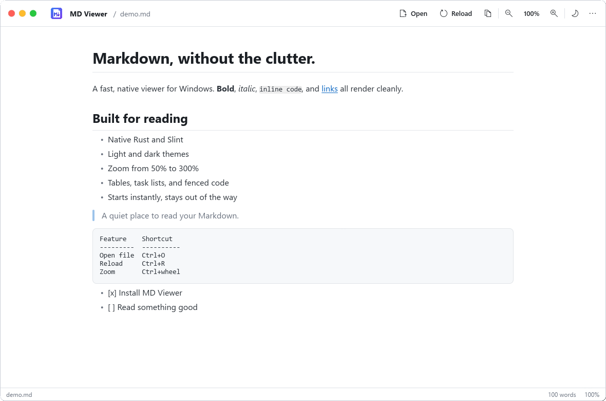
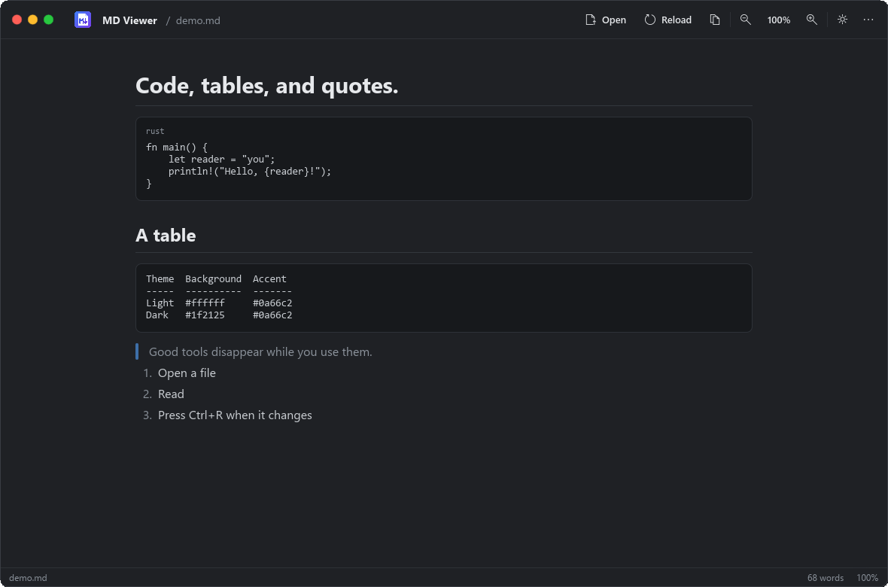

<p align="center">
  
</p>

<h1 align="center">MD Viewer</h1>

<p align="center">A fast, native Markdown viewer for Windows, built with Rust and Slint.</p>

<p align="center">
  <a href="https://github.com/MAXX-2628/md-viewer/releases/latest"></a>
  <a href="LICENSE"></a>
  
</p>

| Light | Dark |
| --- | --- |
|  |  |

MD Viewer is a small desktop app for reading Markdown on Windows. It is a native Rust binary, not an Electron or browser wrapper: it starts quickly, renders clean typography, and stays out of the way.

## Features

- Native Rust and Slint interface with no web runtime
- Light and dark themes
- A centered reading column with comfortable line lengths
- Zoom from 50% to 300% with `Ctrl` + mouse wheel or the keyboard
- Headings, lists, task lists, tables, blockquotes, footnotes, strikethrough, and fenced code blocks
- Open files, reload them from disk, and copy the Markdown source
- Remembers the last document, theme, and zoom level
- Per-user installer with optional `.md` and `.markdown` file association
- No telemetry, no accounts, and no document uploads

## Install

Download **MDViewerSetup-0.6.0.exe** from the [latest release](https://github.com/MAXX-2628/md-viewer/releases/latest) and run it. The installer is per-user, so it does not require administrator rights.

To make MD Viewer the default for Markdown files, open the **...** menu and choose **Set default for .md**, then pick MD Viewer in Windows Default Apps. Windows always asks the user to confirm default app changes.

## Build from source

Requirements: Windows 10 or 11, the Rust toolchain with the MSVC linker, and Rust 1.85 or newer (the project uses the 2024 edition).

```powershell
git clone https://github.com/MAXX-2628/md-viewer.git
cd md-viewer
cargo build --release
cargo test
.\target\release\md-viewer.exe
```

To build the installer, install [NSIS 3](https://nsis.sourceforge.io/) and run:

```powershell
makensis installer\install.nsi
```

The installer is written to `dist\MDViewerSetup-0.6.0.exe`.

## Keyboard shortcuts

| Action | Shortcut |
| --- | --- |
| Open a file | `Ctrl+O` |
| Reload the current file | `Ctrl+R` |
| Zoom in | `Ctrl++` or `Ctrl+=` |
| Zoom out | `Ctrl+-` |
| Reset zoom | `Ctrl+0` |
| Zoom with the wheel | `Ctrl` + mouse wheel |

## How it works

MD Viewer parses Markdown with [pulldown-cmark](https://github.com/pulldown-cmark/pulldown-cmark) and draws the interface with [Slint](https://slint.dev/). Documents are read from disk and kept on your machine. Remote images are not fetched, and links open in your default browser.

## License

Licensed under the [Apache License 2.0](LICENSE).

---

If MD Viewer is useful, a star helps other people find it.
